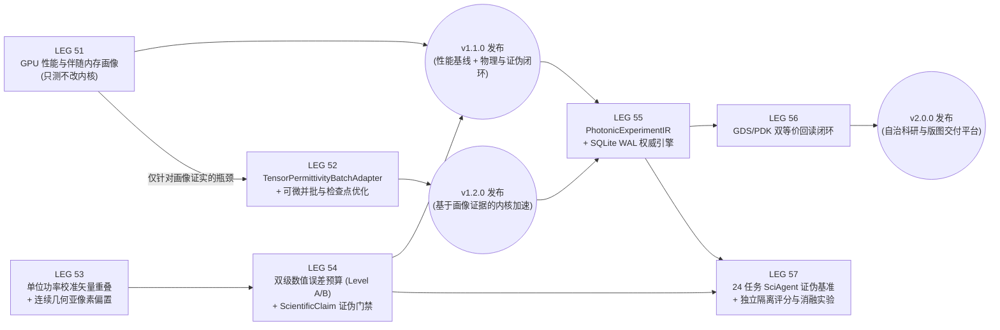

# AgentFDTD v2.0 (Wave E–G · LEG 51–57) Master Design Specification (Rev 2 Approved)

> [!IMPORTANT]
> **v2.0 最高优先级四条架构硬约束（Hard Architectural Invariants）**
> 1. **科学结论与程序执行权限分离**：仿真程序正常执行（`exit 0`）$\ne$ 科学命题成立。合法的 `REFUTED`（证伪）与 `INCONCLUSIVE`（证据不足/落入误差带）是正常科学结论，驱动程序如实报告时必须以 `exit 0` 正常结项并归档；唯有当驱动程序**越权谎报结论**（例如实测为 `INCONCLUSIVE` 却在 `readout.json` 中声称 `SUPPORTED`）或篡改证据链时，公证器才以 **Exit 66 (`false_scientific_claim` / `tamper_detected`)** 拦截。
> 2. **数值误差等级不可混淆（`assurance_level` 强制分级）**：严禁将经验数值残差估计冒充为经数学严格证明的误差上界。所有 `NumericalErrorBudget` 与 `ScientificClaim` 必须显式携带 `assurance_level ∈ {"estimated", "certified"}` 字段：
>    - **Level A (`assurance_level = "estimated"`)**：基于网格加密外推、尾迹稳定度与包围盒残差的经验不确定度估计，仅可签发受限工程结论（`SUPPORTED` + `assurance_level: "estimated"`），用于筛选与触发消歧实验；
>    - **Level B (`assurance_level = "certified"`)**：仅当误差项具备明确适用前提的数学上界或独立解析/双求解器严格包络证明时，方可签发 `assurance_level: "certified"`。
> 3. **GPU 性能目标不得绑架物理正确性门禁**：重算步数降低比例、多保真算力节省比例等指标一律定位为**性能探索 KPI（报告实测值）**，绝不作为物理正确性通过与否的硬门禁，严禁为凑加速比而缩短仿真时长、放宽收敛阈值或绕过验收。
> 4. **求解器仓库权威路径与受控变更**：本地开发仓库中的 `src/torchfdtd`（软链接至 `$SOLVER_FORK`）为唯一权威求解器开发源，独立发行包中的 `dist/public/vendor/torchfdtd` 由 `tools/export_public.sh --bundle-solver` 从已提交的求解器 SHA 确定性打包生成。任何求解器改动必须保持单算例默认路径回归通过、负对照齐全、记录精确 commit SHA。

---

## 一、三层架构与修订后的开发依赖图

为了避免底层 CUDA 并批研发（LEG 52）阻塞核心物理建模（LEG 53）与科学证伪门禁（LEG 54），同时将 GDS 版图交付与 Agent 基准评测解耦为独立验收单元，修订后的 **LEG 51–57 依赖关系与版本节奏** 如下：

| 版本里程碑 | 包含 Leg | 资源标签 | 是否改求解器 (`fork`) | 首轮预算上限 | 阶段完成标志 |
| :--- | :--- | :--- | :--- | :--- | :--- |
| **`v1.1.0`** | **LEG 51** | `GPU` | **否** | `0.6 GPU-h`（超出则报 `partial`） | 冻结 RTX 5070 Ti 性能与伴随内存基线，定位真实瓶颈 |
| **`v1.1.0`** | **LEG 53** | `GPU` | **否** | `0.5 GPU-h` | 通过解析场 $\eta=1/0$ 自检的矢量重叠算子 + 亚像素连续偏置与齿边扫描契约 |
| **`v1.1.0`** | **LEG 54** | `GPU` | **否** | `0.3 GPU-h` | 实现 Level A/B 双级误差预算与 `ScientificClaim` 四态门禁 |
| **`v1.2.0`** | **LEG 52** | `fork` | **是** | `0.6 GPU-h` | 分步落地 `TensorPermittivityBatchAdapter`、可微并批与检查点成本优化 |
| **`v2.0.0`** | **LEG 55** | `neither` | **否** | `0.3 GPU-h` | `PhotonicExperimentIR` + SQLite WAL 单一权威事务引擎 + RO-Crate 导出 |
| **`v2.0.0`** | **LEG 56** | `GPU` | **否** | `0.4 GPU-h` | 复用/扩展 `torchfdtd` GDS 能力，完成 PDK LayerStack 与几何/物理双等价回读 |
| **独立论文/评测** | **LEG 57** | `GPU` | **否** | `0.6 GPU-h` | 评分器与被测 Agent 严格隔离的 24 任务证伪基准集 + 裸求解器消融对比 |

---

## 二、逐 Leg 详细设计规范（已落实全部评审修订）

### LEG 51：FDTD GPU 性能剖析与伴随内存画像
**（FDTD GPU Performance & Adjoint Memory Characterization — 立即可启动）**

#### 1. 目标与边界
不对 `src/torchfdtd` 做任何修改。在固定硬件（RTX 5070 Ti）与现有验收夹具上，测量正向与伴随路径的真实成本指标，回答三个核心问题：
1. 在哪些网格规模下属于 Host Launch 开销主导，哪些规模下已经打满 HBM 显存带宽？
2. 现有 `cuda_graph.py`（`CudaStepGraphs`）和 `tensor_batch.py` 究竟覆盖了哪些路径，逆向设计使用的 `DifferentiablePlaneSimulation` 前向与伴随重算段存在多少未覆盖开销？
3. 二项式检查点（`checkpoints = 2, 4, 8, 16`）在 `device / host / hierarchical` 存储下的重算步数与 PCIe 传输耗时曲线如何？

#### 2. 修正后的测量指标体系（摒弃简单线性相加假设）
由于 CUDA Host 发射、Kernel 执行与异步传输存在重叠，不再使用简单的 $T_{\text{step}} = T_{\text{launch}} + T_{\text{kernel}} + \dots$ 互斥相加公式，而是独立采集以下可复核物理量：
- **`wall_time_sec`**：包含 Graph 捕获、内存准备、执行与 `torch.cuda.synchronize()` 的端到端墙钟时间；
- **`gpu_active_time_ms`**：通过 `torch.cuda.Event(enable_timing=True)` 测量的设备端流活跃时间；
- **`kernel_launch_count`**：通过 `torch.profiler` 统计的 CUDA Kernel 发射总次数；
- **`dram_bytes_estimate` & `effective_bw_gbps`**：基于网格尺寸、场分量数、CPML 区与更新步数计算的理论最小 HBM 读写字节数及有效带宽；
- **`recompute_forward_steps` & `checkpoint_transfer_ms`**：伴随反向传播触发的前向重算总步数与 Host-GPU 检查点搬运耗时；
- **`peak_allocated_bytes` & `peak_reserved_bytes`**：PyTorch CUDA 分配器真实峰值显存；
- **批量三指标**：分别报告 `time_to_one_result`（单结果延迟）、`total_throughput`（单位时间完成案例数）与 `time_to_gradient`（端到端梯度时间）。

#### 3. 分层实验矩阵与预算熔断规则
- **首轮预算上限**：`0.6 GPU-h`（36 GPU 分钟）。按从快到慢（Small $\to$ Medium $\to$ Large，步数 $1,000 \to 5,000 \to 20,000$）顺序执行；若触及预算上限或某大网格触发显存准入拒绝，立即如实记录已完成矩阵点与未覆盖/拒绝原因，返回合法 `partial` 结论，**严禁缩减网格或步数冒充跑完**。
- **落地文件**：`src/leg51_gpu_characterization.py`、`configs/leg51-gpu-characterization.json`、`checks/test_leg51_gpu_characterization.py`、`docs/leg51-<date>.md`。
- **预声明验收判据（修正 A1 容差区分）**：
  - **A1a（同精度同算子路径逐位一致）**：`cuda_graph (width=1..64)` 与无图 `fused` 单算例路径（同一 CUDA kernel，仅改变 Host 发射频率）输出通量与场摘要必须满足严格逐位一致（`0.0` 误差）；
  - **A1b（跨执行路径数值容差）**：`torch` 路径与 `fused` 路径、不同分块大小之间的通量相对误差 $\le 10^{-12}$，伴随梯度相对误差 $\le 10^{-10}$。
  - **A2（端到端计时完整性）**：`readout.json` 同时记录 `setup_graph_capture_sec` 与 `steady_replay_sec`。

---

### LEG 52：张量介电常数并批适配器、可微并批 FDTD 与检查点成本优化
**（`TensorPermittivityBatchAdapter`, Batched Differentiable FDTD & Checkpoint Optimizer — 基于 LEG 51 画像按需推进）**

#### 1. 修正接口不兼容矛盾（评审修订 #1）
现有 `tensor_batch.py:82` 接收 `Project` 对象并显式拒绝张量材料（`if uses_tensor(p): raise ValueError(...)`）。因此不能直接把 `eps_list: list[Tensor]` 传给 `run_tensor_batch`。
必须在 `src/torchfdtd/torchfdtd/` 中按**严格四步隔离法**递进开发（每完成一步跑通回归测试，严禁一次性混合修改多个子系统）：

1. **Step 1 — 实现无梯度 `TensorPermittivityBatchAdapter`**：
   - 接收固定基准 `Project`（定义共享网格尺寸、PML、源与监视面）与一组满足形状/设备约束的介电常数张量 `eps_batch: tuple[Tensor, ...]`（形状 `(Nx, Ny, Nz)` 或 `(Nx, Ny, Nz, 3)`，位于同一 CUDA 设备）；
   - 为每个 $\varepsilon_b$ 实例化独立的 `YeeGrid` 材料系数槽位，直接绑定至 `FusedBatchYeeCUDA` 指针表与 `CudaStepGraphs`，服务于有限差分扰动、M3 二值结构复核与工艺角正向评估。
2. **Step 2 — 扩展至可微伴随并批 `FusedBatchTransposeYeeCUDA`**：
   - 将指针表机制扩展至 `differentiable.py` 的旋度转置反向更新核，支持多个不同介电常数算例各自注入伴随源种子 $\partial J_b / \partial \tilde{\mathbf{E}}_b$ 并独立累积梯度 $\partial J_b / \partial \varepsilon_b$。
3. **Step 3 — 检查点预算成本优化器（`select_optimal_adjoint_options`）**：
   - 利用 LEG 51 实测的 $t_{\text{fwd}}$、$t_{\text{bwd}}$ 与 PCIe 传输速率，在给定显存预算下从候选配置集中自动选择端到端时间最短的 `(checkpoints, device_checkpoints, host_checkpoints)`。
4. **Step 4（可选探索，与主路径隔离）**：
   - 多保真线搜索（粗模型排序候选步长，高精度 FDTD 最终验收）与带独立残差窗口校验的尾迹提前终止探测。

#### 2. 预声明验收判据（修正性能指标定位）
- **A1（单算例默认路径零回归）**：单算例默认路径与 `$SOLVER_FROZEN` 逐位一致（`0.0` 误差）。
- **A2（并批正向与伴随数值等价）**：`TensorPermittivityBatchAdapter` 正向通量与单算例逐个运行差异 $\le 10^{-12}$；可微并批伴随梯度与单算例独立求导相对误差 $\le 10^{-12}$，且跨算例串扰测试（修改算例 2 伴随种子，算例 1/3/4 梯度变化为 `0.0`）通过。
- **A3（检查点优化器验收）**：不预设固定的“重算减少 40%”硬门槛，而是要求在相同显存上限与数值契约下，优化器自动选出的配置端到端耗时**不劣于**默认固定配置，并完整记录候选集代价曲线与调度开销。

---

### LEG 53：经单位功率校准的全矢量光纤模式重叠与连续几何亚像素偏置
**（Calibrated Vector Mode Overlap & Piecewise-Differentiable Subpixel Etch-Bias）**

#### 1. 修正矢量模式重叠积分公式与三项解析自检基准（评审修订 #2）
在采用标准时间平均复坡印廷功率定义：
$$P = \frac{1}{2} \operatorname{Re} \iint_S (\tilde{\mathbf{E}}_t \times \tilde{\mathbf{H}}_t^*) \cdot \hat{\mathbf{n}}\, dS$$
的前提下，若分子使用双向 Lorentz 互易投影积分：
$$I_{\text{rec}}(\omega) = \iint_S \left(\tilde{\mathbf{E}}_t(\omega) \times \tilde{\mathbf{H}}_{t,\text{fib}}^*(\omega) - \tilde{\mathbf{H}}_t(\omega) \times \tilde{\mathbf{E}}_{t,\text{fib}}^*(\omega)\right) \cdot \hat{\mathbf{n}}\, dS$$
当待测场恰等于正向传播的目标模式 $(\tilde{\mathbf{E}}_t = \tilde{\mathbf{E}}_{t,\text{fib}}, \tilde{\mathbf{H}}_t = \tilde{\mathbf{H}}_{t,\text{fib}})$ 时，$I_{\text{rec}}(\omega) = 4 P_{\text{fib}}(\omega)$；而当待测场为反向传播模式 $(\tilde{\mathbf{E}}_t = \tilde{\mathbf{E}}_{t,\text{fib}}, \tilde{\mathbf{H}}_t = -\tilde{\mathbf{H}}_{t,\text{fib}})$ 时，$I_{\text{rec}}(\omega) = 0$。
因此，**严格满足单位功率归一化（$\eta \in [0, 1]$）的全矢量模式耦合效率公式分母必须为 $16 P_{\text{in}}(\omega) P_{\text{fib}}(\omega)$**：
$$\eta_{\text{3D}}(\omega) = \frac{\left|\iint_S \left(\tilde{\mathbf{E}}_t(\omega) \times \tilde{\mathbf{H}}_{t,\text{fib}}^*(\omega) - \tilde{\mathbf{H}}_t(\omega) \times \tilde{\mathbf{E}}_{t,\text{fib}}^*(\omega)\right) \cdot \hat{\mathbf{n}}\, dS\right|^2}{16\, P_{\text{in}}(\omega)\, P_{\text{fib}}(\omega)}$$
同理，对于 2D TE 截面（传播法向 $\hat{\mathbf{n}} = +\hat{\mathbf{z}}$，切向场为 $\tilde{E}_y, \tilde{H}_x$，且 $(\tilde{\mathbf{E}}_t \times \tilde{\mathbf{H}}_t^*) \cdot \hat{\mathbf{z}} = -\tilde{E}_y \tilde{H}_x^*$）：
$$\eta_{\text{2D-TE}}(\omega) = \frac{\left|\int_{x_1}^{x_2} \left(\tilde{E}_y(x,\omega) H_{x,\text{fib}}^*(x,\omega) + \tilde{H}_x(x,\omega) E_{y,\text{fib}}^*(x,\omega)\right) dx\right|^2}{16\, P_{\text{in}}(\omega)\, P_{\text{fib}}(\omega)}$$

**强制前置解析场自检（必须在接入 FDTD 前 100% 通过）**：
1. **自洽性测试（Identity Test）**：令输入解析场等于任意幅值/相位的归一化正向目标模式，验证 $\eta = 1.000000000000$（机器精度 `< 1e-15`）；
2. **正交性测试（Orthogonality Test）**：令输入场为奇对称高阶模（如 $\text{TE}_1$ 或反对称厄米-高斯模），验证与基模重叠 $\eta < 10^{-14}$；
3. **方向分离测试（Directional Isolation Test）**：令输入场为正向模（功率 $P_+$）与反向反射模（功率 $P_-$）的叠加 $\tilde{\mathbf{E}}_t = \alpha \mathbf{E}_m + \beta \mathbf{E}_m, \tilde{\mathbf{H}}_t = \alpha \mathbf{H}_m - \beta \mathbf{H}_m$，验证正向重叠算子精确提取 $|\alpha|^2 P_m / P_{\text{in}}$ 而完全抑制反向分量 $\beta$。

#### 2. 修正连续几何亚像素边界的可微性表述与网格周期扫描测试（评审修订 #3）
- **准确数学定性**：区间交集占空比 $f_i(x_L, x_R) = \frac{1}{\Delta x}\max(0, \min(x_{i+1}, x_R) - \max(x_i, x_L))$ 对边界坐标 $(x_L, x_R)$ 是**分段线性连续、几乎处处可微（Piecewise Differentiable a.e.）**，但在齿边界恰好穿过网格节点 $x_L = x_i$ 或 $x_R = x_i$ 时存在一阶导数折点（Kink），在两齿合并/消失时存在拓扑奇点。
- **不夸大承诺**：
  1. 连续边界参数化消除的是**“优化用连续灰阶密度 $\rho \in (0,1)$ 与制造用二值结构之间的参数表示失配（Representation Mismatch）”**，不再宣称“全局光滑无奇点”或“离散误差为零”；
  2. 明确区分**几何参数化分辨率**（亚像素占空比可表达 $5\text{ nm}$ 边界位移）与**电磁场数值离散精度**（$20\text{ nm}$ 网格上的亚像素响应仍带有 $O(\Delta x^p)$ 网格离散误差，需由网格加密阶梯量化）。
- **新增齿边界跨网格扫描测试（Edge-Crossing Sweep Test）**：
  令单个光栅齿右边界 $x_R$ 以 $\delta x = 1\text{ nm}$ 步长连续跨越一个完整 $20\text{ nm}$ Yee 网格周期（共 21 个点），记录每个位置的：
  - 目标函数值 $\eta(x_R)$（验证连续无跳变）；
  - 伴随导数 $\partial \eta / \partial x_R$ 与中心有限差分导数（在网格单元内部验证相对误差 $\le 10^{-5}$，在网格节点折点处量化左右导数跃迁幅值与单侧差分一致性）。

---

### LEG 54：双级数值误差预算（Level A / Level B）与 `ScientificClaim` 证伪门禁
**（Two-Tier Numerical Error Budget & Scientific Claim Falsification Gate — 核心可信度基石）**

#### 1. 修正误差预算模型：严格区分 `estimated`（Level A）与 `certified`（Level B）（评审修订 #4）
由于网格外推残差 $U_{\text{mesh}}$（依赖处于渐近收敛区）、时域尾迹漂移 $U_{\text{time}}$（单窗口稳定不能绝对排除双共振慢拍）以及包围盒能量闭合残差 $U_{\text{box}}$（总能量守恒不能约束模式相位误差）属于**经验误差指标**而非数学绝对上界，系统将 `NumericalErrorBudget` 严格划分为两个等级：

| 等级 (`assurance_level`) | 构成条件 | 允许签发的最高结论形式 |
| :--- | :--- | :--- |
| **Level A (`"estimated"`)** | 完成三档单调网格收敛阶梯（计算经验 GCI/Richardson 残差 $U_{\text{mesh}}$）、时域能量衰减 $\le 10^{-9}$ 且通量漂移 $U_{\text{time}}$ 受控、包围盒闭合 $U_{\text{box}}$ 受控 | 签发 `claim_status = "SUPPORTED"`，但必须同时标记 **`assurance_level = "estimated"`**（明确声明为经验误差预算下的工程支持结论） |
| **Level B (`"certified"`)** | 除满足 Level A 外，还必须具备：**（1）独立求解器（如 RCWA / Meep / 解析解）在同一目标物理量（含模式相位/重叠）上的交叉对账残差 $U_{\text{cross}}$ 包络**，或具有显式数学误差界定理支撑的解析夹具 | 方可签发 `claim_status = "SUPPORTED"` 且 **`assurance_level = "certified"`** |

#### 2. 修正 `ScientificClaim` 区间跨越判定逻辑（特别是 `REFUTED` vs `INCONCLUSIVE`）
设某项指标（如效率提升量 $\Delta \eta$ 或某有限工艺角效率 $\eta_{\text{corner}}$）的点估计值为 $\hat{q}$，合成不确定度半径为 $U_q > 0$，目标阈值为 $q_{\text{min}}$，定义不确定度区间为 $[q_{\text{low}}, q_{\text{high}}] = [\hat{q} - U_q, \hat{q} + U_q]$：
1. **`UNSUPPORTED`**：缺少必需证据文件、基线与候选的材料栈/波长/源归一化不一致、或网格收敛阶梯出现方向反转（非单调，无法建立有效 $U_{\text{mesh}}$）。
2. **`SUPPORTED`**：对主目标及所有预声明的有限工艺角，整个不确定度区间下界严格高于阈值：
   $$q_{\text{low}} = \hat{q} - U_q > q_{\text{min}}$$
3. **`REFUTED`（修正！）**：仅当主目标或某一预声明工艺角的**整个不确定度区间上界都跌破阈值**时，才判定为确定性证伪：
   $$q_{\text{high}} = \hat{q} + U_q < q_{\text{min}}$$
4. **`INCONCLUSIVE`（区间跨越阈值）**：只要点估计与误差区间跨越阈值（即 $q_{\text{low}} \le q_{\text{min}} \le q_{\text{high}}$，哪怕点估计 $\hat{q} < q_{\text{min}}$ 或 $\hat{q} > q_{\text{min}}$），一律判定为 **`INCONCLUSIVE`**，并自动输出针对最大误差分量 $\arg\max(U_{\text{mesh}}, U_{\text{time}}, U_{\text{cross}})$ 的下一步消歧实验处方！

---

### LEG 55：求解器无关 `PhotonicExperimentIR` 与 SQLite WAL 单一权威实验引擎
**（`PhotonicExperimentIR` & Single-Authority SQLite WAL Experiment Engine）**

#### 1. 修正双写一致性风险与恢复契约（评审修订 #6）
摒弃“同时独立写 JSONL 和 SQLite”的双写脆弱设计，建立严格的事务与故障恢复契约：
1. **单一权威状态源（Single Source of Truth）**：
   - `runs/experiments.db`（开启 `PRAGMA journal_mode=WAL; PRAGMA synchronous=NORMAL; PRAGMA foreign_keys=ON;`）作为多阶段实验状态的**唯一权威存储**；
   - 采用 **Transactional Outbox 模式**：当一次运行经公证器验收完成时，在同一个 SQLite 事务内写入 `experiment_runs` 状态更新与 `ledger_outbox` 记录，再由确定性投影器（Projector）幂等追加/同步至 `runs/ledger.jsonl`（以 `run_id` 为唯一键去重）。即使中途断电，重启时重放未刷新的 outbox 即可保证 SQLite 与 `runs/ledger.jsonl` 100% 一致。
2. **并发占用与幂等契约**：
   - 幂等键：`UNIQUE(experiment_id, stage_id, candidate_id, fidelity_level)`；重复提交同一规格的实验步直接返回已有记录而不重复启动 GPU；
   - Worker 租约：`workers (lease_id, experiment_id, fencing_token, heartbeat_utc, expires_utc)`，携带单调递增 `fencing_token` 防止僵尸进程覆写结果。
3. **实事求是的崩溃恢复契约（修正“零重复计算”过强表述）**：
   - **已持久化并完成公证的阶段（Completed & Notarized Stages）**：跨 Session 恢复时 100% 复用，**零重复执行**；
   - **运行中崩溃的未完成阶段（Interrupted In-Flight Stage）**：先校验 `ResidentRestartJournal` 的双槽 SHA-256 完整性，从最近一个合法的块边界 Checkpoint 恢复（仅重算最后一次 Checkpoint 之后未落盘的若干时间步），若两个槽位均损坏或尚未写入首个 Checkpoint，则将该单步标记为 `restarted_from_step_0` 并完整记录重算审计轨迹。
4. **`PhotonicExperimentIR`（`src/experiment_ir.py`）**：
   - 统一建模材料栈、几何原语、激励源、监视器、目标函数与工艺规则，支持编译至 `TorchFDTD`、`RCWA`、`Meep` 与 `GDS`，对不等价的维度/边界转换强制返回 `UNSUPPORTED_BY_BACKEND`。

---

### LEG 56：GDS/PDK 几何与物理双等价交付闭环
**（GDS/PDK Dual-Equivalence Delivery Loop — 独立验收单元）**

#### 1. 复用现有能力与补齐 SOI PDK 语义（评审修订 #7a）
1. **先盘点复用再扩展**：先核查并复用 `torchfdtd` 内置的 GDS/几何工具，不重复造底层二进制解析轮子；
2. **完整 SOI PDK LayerStack 契约（不止于 `(1, 0)` 层号）**：
   - 定义显式的 `SOIPDKSpec`：包含层映射 `layer_map`（如全刻蚀波导层 `(1, 0)`、浅刻蚀光栅槽层 `(2, 0)`）、对应物理厚度 `thickness_nm`、刻蚀深度 `etch_depth_nm`、侧壁倾角 `sidewall_angle_deg`（默认 $90^\circ$）、包层/衬底材料折射率、版图数据库网格精度 `dbu_um = 0.001`（$1\text{ nm}$）以及 DRC 规则（最小线宽、最小间距、最小面积）。
3. **双等价回读公证门禁（Check 13 in `checks/post_notary.py`）**：
   - **几何与 PDK/DRC 等价**：从导出的 `.gds` 文件独立回读多边形，结合 `SOIPDKSpec` 还原三维材料区，验证齿数/拓扑一致、边界坐标舍入偏差 $\le 1\text{ dbu}$（$1\text{ nm}$）、0 DRC 违规；
   - **回读物理等价**：将回读还原的几何通过亚像素投影生成 Yee 网格并运行独立 FDTD，验证 $|\hat{\eta}_{\text{gds\_readback}} - \hat{\eta}_{\text{design}}| \le U_{\text{discretization}}$。

---

### LEG 57：独立隔离评分的 SciAgent 科学证伪基准集与消融实验
**（Isolated-Evaluator SciAgent Falsification Benchmark & Ablation Study — 独立验收单元）**

#### 1. 评分隔离架构与统计学诚实表述（评审修订 #7b）
1. **评分器与被测系统严格物理隔离（Anti-Self-Grading Isolation）**：
   - 评测裁判器（`benchmarks/harness/independent_judge.py`）运行在独立的只读进程中，持有加密/只读封存的 **Ground-Truth Oracle（解析精确解、超高分辨率收敛参考解或预埋缺陷标签）**；
   - 裁判器**不调用**被测 Agent 的自评输出，而是直接对比被测工作流提交的最终结论状态（`SUPPORTED / REFUTED / INCONCLUSIVE / UNSUPPORTED`）与 Ground-Truth Oracle 是否一致。
2. **对错误验证率（False Verification Rate, FVR）的严谨统计报告**：
   - 24 个标准任务（6 大类 × 4 题，含 16 个精心设计的负对照/陷阱题与 8 个正对照题）；
   - 验收目标是在当前 24 题基准集内实现实测 `empirical_FVR == 0/16 (0.0%)`；
   - **同时在报告中强制输出 Clopper-Pearson 单侧 95% 二项分布置信上限**（例如 $0/16$ 对应 $95\%$ 置信上限约 $17.1\%$），明确区分“基准集内零误判”与“跨任意未知任务的统计风险上界”。
3. **同场消融实验（Ablation Study）**：
   - 在完全相同的 24 个任务描述与相同 GPU 算力预算下，对比：
     - **Group A（Baseline）**：直接使用裸 `Python + TorchFDTD`（无 `post_notary.py`、无 `NumericalErrorBudget`、无 `ScientificClaim` 门禁）；
     - **Group B（AgentFDTD v2.0）**：完整启用确定性公证与科学证伪内核；
   - 量化对比四项指标：`Task Success Rate`、`Empirical FVR (含 95% CI)`、`Autonomous Recovery Rate`、`GPU-hours per True Positive Claim`。
